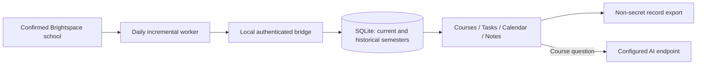

# Hackathon

A local learning assistant built on [Bulter](https://github.com/frankrainrp/Bulter): retained course records, tasks, reminders and source-grounded AI.

[中文说明](README.zh-CN.md)

## Interface language and optional AI

The interface defaults to English. Select **中文** on the first AI setup screen or in **Preferences → Language**; existing course titles, notes and conversation history keep their original text. Example courses are opt-in and clearly labelled. New panels start empty.

First launch offers **Local on this computer**, **DeepSeek API**, or **Skip for now**. The Windows CPU engine is pinned in this repository; model weights are separate and download only after an explicit choice. An existing loopback OpenAI-compatible service is also supported. DeepSeek keys are entered through the masked setup field and protected with Windows DPAPI. Provider charges and the local billing demonstration are separate.

Read [AI setup and storage](my-app/docs/local-ai.md), [Windows package startup](distribution/GETTING-STARTED.md), [language verification](LOCALIZATION.md), and the [file-by-file change record](docs/CHANGE-FILES-2026-10-21.md).

## Configure your school first

Open **Courses → School, semester and daily checks**. Enter your school name and HTTPS LMS entry, preview the normalized domain, and confirm the current semester and course selection. TP/RP buttons are examples, never an inferred user identity. Only selected active courses are downloaded; switching semesters retains historical records.

Connections currently support the explicit `tplms.polite.edu.sg` and `rplms.polite.edu.sg` Brightspace hosts with a restricted Microsoft SSO policy. Other public custom URLs can be saved as profiles, but login, sync and schedule activation fail closed until a reviewed connection policy/adapter is added. A DNS preflight is not advertised as making an arbitrary URL safe.

Daily preferences default to **09:00 Asia/Singapore**, with a configurable time and UTC alternative. Saving preferences does not enable a background task. Daily checks can miss shorter-notice deadlines.

## Setup guide — Windows

### 1. What to download

| Download | Version | Needed for | Link |
| --- | --- | --- | --- |
| Git | any | Cloning the repo | [git-scm.com](https://git-scm.com/download/win) |
| Node.js | 24 (20+ works) | Running the app | [nodejs.org](https://nodejs.org/) |
| pnpm | 9 | Installing app packages | Run `npm install -g pnpm@9` after Node is installed |
| Python | 3.11 or newer | PoliteMall login and sync | [python.org](https://www.python.org/downloads/) — tick **Add python.exe to PATH** in the installer |
| Microsoft Edge | latest | Opening the app and PoliteMall login | Already installed on Windows |
| Ollama | latest | Optional — only if you want to use your own Ollama models; the app can download a local model from its setup screen | [ollama.com](https://ollama.com/download) |

Close and reopen your terminal after installing, then check everything is found:

```powershell
git --version
node -v
pnpm -v
python --version
```

### 2. Get the code and install packages

Run these in PowerShell. The first install takes a few minutes.

```powershell
git clone https://github.com/frankrainrp/Hackathon.git
cd Hackathon/my-app
pnpm install --frozen-lockfile
python -m venv ops/lms-sync/.venv
./ops/lms-sync/.venv/Scripts/python.exe -m pip install -r ops/lms-sync/requirements.txt -c ops/lms-sync/requirements-ci.txt
New-Item -ItemType Directory -Force ops/lms-sync/.private
```

### 3. Start the app

From `Hackathon/my-app`:

```powershell
$env:BUTLER_DB_PATH = "$PWD/ops/lms-sync/.private/butler.sqlite"
pnpm --filter @smart-hub/web dev --hostname 127.0.0.1
```

Wait for `Ready`, then open <http://127.0.0.1:3000> in Edge. The first page load takes 10–20 seconds while it compiles. Leave this terminal open; press `Ctrl+C` to stop the app. Set `BUTLER_DB_PATH` again every time you open a new terminal, or your records won't be loaded.

### 4. Connect PoliteMall

1. In the app, open [Courses](http://127.0.0.1:3000/?view=courses) and confirm your school, semester and modules.
2. Stop the app (`Ctrl+C`), then in the same terminal run:

   ```powershell
   cd ops/lms-sync
   .\.venv\Scripts\python.exe lms_sync.py setup
   ```

3. Start the app again (step 3, from `Hackathon/my-app`).
4. In a second terminal, from `Hackathon/my-app/ops/lms-sync`, log in and download your files:

   ```powershell
   .\.venv\Scripts\python.exe lms_sync.py login     # opens Edge for your school Microsoft login
   .\.venv\Scripts\python.exe lms_sync.py catalog   # finds your semester and modules
   .\.venv\Scripts\python.exe lms_sync.py sync      # downloads files for the selected modules
   ```

Sync only works for TP and RP PoliteMall. More detail, including the optional daily check, is in [School profile workflow](my-app/ops/lms-sync/PROFILE_WORKFLOW.md).

The rebuilt portable launcher opens the local UI only. It does not log in, save a school session, sync or register a schedule. Existing [release ZIPs](https://github.com/frankrainrp/Hackathon/releases) are not automatically updated by this source change.

## Persistence and checks

School profiles, all confirmed semesters, course status/selection, sync outcomes, notes and task state remain on this computer across restarts and login expiry. Credentials are separate DPAPI-encrypted scoped session files. Export non-secret records from Courses and back up the local database/archive; retention is not a guarantee against disk loss. See the [retention and recovery guide](my-app/ops/lms-sync/PROFILE_WORKFLOW.md#retention-export-and-recovery).

`install-schedule.ps1 -DryRun` generates a daily plan. Only an explicitly approved later `-Install` can register it; the app does not silently replace old hourly tasks. No deployment or external automation is enabled.

GitHub Actions runs Node regression tests, TypeScript checks and a production build on Ubuntu, plus Python/DPAPI tests on Windows. API integration tests use synthetic records in temporary storage, with no school login or private downloads.



School assignment deadlines come from Brightspace. Missing dates stay unknown; AI does not invent school deadlines. Scans still need OCR, Quiz/forum/LTI submissions are not covered, and DeepTutor is not integrated. Source and artwork remain attributed to Bulter and existing third-party notices.
## Build the current Windows package

From `my-app`, run `pnpm --filter @smart-hub/web build`. Then, from the repository root, run `node tools/package-windows.cjs <new-absolute-output-folder>`. The packager uses the locally present pinned engine and Node runtime and refuses to overwrite an existing installation. It includes no model weights, private database, key or school session. See the distribution quick start for system prerequisites.

Source updates on `main` do not replace previously uploaded release assets. A binary release must be published separately; the old Releases download is not claimed to be the new build.
