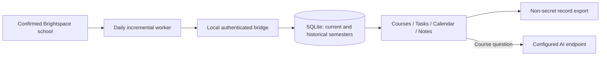

# Hackathon

A local learning assistant built on [Bulter](https://github.com/frankrainrp/Bulter): retained course records, tasks, reminders and source-grounded AI.

[中文说明](README.zh-CN.md)

## Configure your school first

Open **Courses → School, semester and daily checks**. Enter your school name and HTTPS LMS entry, preview the normalized domain, and confirm the current semester and course selection. TP/RP buttons are examples, never an inferred user identity. Only selected active courses are downloaded; switching semesters retains historical records.

Connections currently support the explicit `tplms.polite.edu.sg` and `rplms.polite.edu.sg` Brightspace hosts with a restricted Microsoft SSO policy. Other public custom URLs can be saved as profiles, but login, sync and schedule activation fail closed until a reviewed connection policy/adapter is added. A DNS preflight is not advertised as making an arbitrary URL safe.

Daily preferences default to **09:00 Asia/Singapore**, with a configurable time and UTC alternative. Saving preferences does not enable a background task. Daily checks can miss shorter-notice deadlines.

## Source quick start — Windows

Use Node 24, pnpm 9, Python 3.11+ and Edge. Ollama is optional for AI; deterministic school facts do not require it.

```powershell
cd my-app
pnpm install --frozen-lockfile
python -m venv ops/lms-sync/.venv
./ops/lms-sync/.venv/Scripts/python.exe -m pip install -r ops/lms-sync/requirements.txt -c ops/lms-sync/requirements-ci.txt
$env:BUTLER_DB_PATH = "$PWD/ops/lms-sync/.private/butler.sqlite"
pnpm --filter @smart-hub/web dev --hostname 127.0.0.1
```

Open [Courses](http://127.0.0.1:3000/?view=courses) and confirm the profile. Then stop the local app, run `lms_sync.py setup`, restart it, and perform manual login/catalog/first-sync only when ready. Full commands and access boundaries are in [School profile workflow](my-app/ops/lms-sync/PROFILE_WORKFLOW.md).

The rebuilt portable launcher opens the local UI only. It does not log in, save a school session, sync or register a schedule. Existing [release ZIPs](https://github.com/frankrainrp/Hackathon/releases) are not automatically updated by this source change.

## Persistence and checks

School profiles, all confirmed semesters, course status/selection, sync outcomes, notes and task state remain on this computer across restarts and login expiry. Credentials are separate DPAPI-encrypted scoped session files. Export non-secret records from Courses and back up the local database/archive; retention is not a guarantee against disk loss. See the [retention and recovery guide](my-app/ops/lms-sync/PROFILE_WORKFLOW.md#retention-export-and-recovery).

`install-schedule.ps1 -DryRun` generates a daily plan. Only an explicitly approved later `-Install` can register it; the app does not silently replace old hourly tasks. No deployment or external automation is enabled.

GitHub Actions runs Node regression tests, TypeScript checks and a production build on Ubuntu, plus Python/DPAPI tests on Windows. API integration tests use synthetic records in temporary storage, with no school login or private downloads.



School assignment deadlines come from Brightspace. Missing dates stay unknown; AI does not invent school deadlines. Scans still need OCR, Quiz/forum/LTI submissions are not covered, and DeepTutor is not integrated. Source and artwork remain attributed to Bulter and existing third-party notices.
